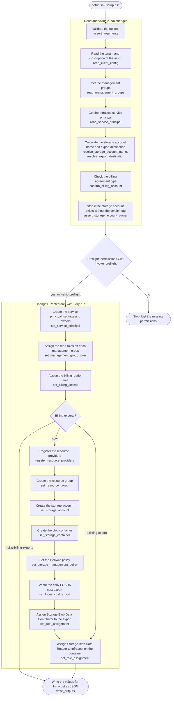
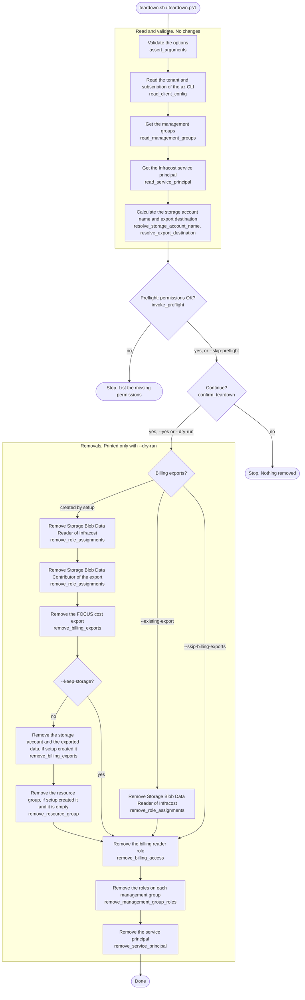

# Setup and teardown scripts

The setup script sets up the Infracost Azure integration with the `az` CLI. It gives the same result as the Terraform module in this repository. Use it if you do not use Terraform.

The teardown script removes what the setup script created. It gives the same result as `terraform destroy`.

You can run each script more than once. The setup script only creates the items that do not exist. The teardown script only removes the items that exist.

| Directory | Shell | Scripts |
| --- | --- | --- |
| `linux/` | bash 3.2 or later on Linux, macOS, WSL or Azure Cloud Shell | `setup.sh`, `teardown.sh`, `common.sh` |
| `windows/` | Windows PowerShell 5.1 or PowerShell 7 | `setup.ps1`, `teardown.ps1`, `common.ps1` |

Each setup and teardown script loads the `common` file from its directory. Keep the three files of a directory together.

The PowerShell scripts use the parameter with the same name in PascalCase, for example `--client-id` becomes `-ClientId` and `--dry-run` becomes `-DryRun`. For the help of a PowerShell script, run `Get-Help .\scripts\windows\setup.ps1 -Full`. For the help of a bash script, run `./scripts/linux/setup.sh --help`.

The two scripts in a pair have the same steps in the same order, with the same names. For example, `set_storage_account` in `setup.sh` is `Set-StorageAccount` in `setup.ps1`.

If Windows blocks the script, run it with `powershell -ExecutionPolicy Bypass -File .\scripts\windows\setup.ps1 ...`.

## Prerequisites

- The [Azure CLI](https://learn.microsoft.com/en-us/cli/azure/install-azure-cli), signed in to the tenant to set up.
- For `linux/`: `sha1sum` or `shasum`, `od`, and `date`. Each script checks for these tools and for `az` before it starts.
- The client ID of the Infracost application. Get it from the Infracost dashboard.
- These permissions for the principal that runs the script:

| Step | Permission |
| --- | --- |
| Service principal | Application Administrator, Cloud Application Administrator, or `Application.ReadWrite.All` |
| Management group roles | Owner or User Access Administrator on each management group |
| Billing role, EA | Enterprise Administrator on the enrollment |
| Billing role, MCA | Billing account owner |
| Billing exports | Owner on the subscription, and billing account access to create the cost export |

## Usage

Sign in and select the subscription that hosts the billing exports storage account:

```bash
az login --tenant <tenant-id>
az account set --subscription <subscription-id>
```

Pass `--tenant-id` and `--subscription` to make sure that the script uses this tenant and subscription. The script stops if the `az` CLI targets a different tenant or subscription. This is important when you can sign in to more than one tenant, for example as an Enterprise Agreement administrator with a different home tenant.

Do a dry run first with `--dry-run`. The script reads the current state and prints each change as a `[dry-run]` line, but does not apply it. Then run the same command without `--dry-run`. The script then prints each change as an `[apply]` line before it applies it.

## Flow

Each step is a function with the same name in both shells, for example `set_storage_account` in bash and `Set-StorageAccount` in PowerShell. Steps that create or remove an item first check if the item exists, so you can run a script more than once.

### Setup



`--skip-billing-access` skips the billing reader role.

### Teardown



`--skip-billing-access` skips the billing reader role. The resource providers stay registered.

## Examples

See [`examples/`](examples/) for the bash and PowerShell commands of each use case: [`ea/`](examples/ea/) for an Enterprise Agreement, and [`mca/`](examples/mca/) for a Microsoft Customer Agreement.

## Options

| Option | Description | Default |
| --- | --- | --- |
| `--client-id <guid>` | Client ID of the Infracost Azure application. Required. | |
| `--tenant-id <guid>` | Tenant to use. The script stops if the `az` CLI targets a different tenant. | Tenant of the `az` CLI. Not checked. |
| `--subscription <guid>` | Subscription that hosts the billing exports. The script stops if the `az` CLI targets a different subscription. | Default subscription of the `az` CLI. Not checked. |
| `--management-groups <a,b>` | Management groups where Infracost gets read access. | Tenant root management group |
| `--roles <a,b>` | Roles on the management groups. | `Reader,Cost Management Reader,Monitoring Reader` |
| `--owners <oid,oid>` | Object IDs to add as owners of the service principal. Existing owners are kept. | No owners |
| `--billing-agreement-type <EA\|MCA>` | Billing agreement of the billing account. | |
| `--billing-account-id <id>` | EA enrollment number, or MCA billing account ID. | |
| `--skip-billing-access` | Do not assign the billing reader role. | |
| `--location <region>` | Region of the storage account and cost export. | |
| `--resource-group <name>` | Resource group of the storage account. | `infracost-billing-exports` |
| `--storage-account <name>` | Name of the storage account. The script stops if the account exists and does not have the `InfracostModuleVersion` tag from the setup script. To use an export that exists, use `--existing-export`. | `infracost` + 15 characters from the tenant ID hash |
| `--existing-export <id,container,path>` | Use a FOCUS cost export that exists. | |
| `--skip-billing-exports` | Do not set up billing exports. | |
| `--dry-run` | Print the changes. Do not apply them. | |
| `--skip-preflight` | Do not check the permissions before the changes. | |

The scripts remove the spaces around each item of a comma-separated list, and ignore empty items.

`--billing-agreement-type` and `--billing-account-id` are necessary, except with `--skip-billing-access`. `--billing-account-id` and `--location` are necessary to create the billing exports.

## Preflight

Before the first change, each script checks that the signed-in principal can do all the steps. The preflight also runs with `--dry-run`. The script lists each check that passed, each check that it could not do, and each check that failed. If an item fails, the script stops before it changes anything.

| Step | Check |
| --- | --- |
| Service principal | Graph directory role: Global Administrator, Application Administrator or Cloud Application Administrator. For a service principal that runs the script: `Application.ReadWrite.All`, or `Application.ReadWrite.OwnedBy` to create. Owner of the Infracost service principal is also accepted when it exists. |
| Management group roles | `Microsoft.Authorization/roleAssignments/read` and `/write` (`/delete` for teardown) on each management group |
| Billing reader role | Billing account owner (MCA) or Enterprise Administrator (EA) role on the billing account, for the signed-in principal |
| Resource providers | `<namespace>/register/action` on the subscription, only for providers that are not registered |
| Billing exports storage | Write actions for the resource group, storage account, container, lifecycle policy and role assignments. Delete actions for teardown. |
| Storage account name | Name is free, if the storage account does not exist yet |
| FOCUS cost export | Billing account owner (MCA) or Enterprise Administrator (EA) role on the billing account, for the signed-in principal. With `--skip-billing-access`, the agreement type comes from the billing account |
| Existing export | Storage account exists, and `roleAssignments/write` on it |

The preflight cannot find these problems, so the run can still fail on them:

- Conditions on role assignments that limit which roles you can assign.
- Deny assignments.
- Custom directory roles that allow you to create a service principal. The preflight reports them as missing. Use `--skip-preflight`.
- Roles that you received a few minutes before the run, because Azure takes time to apply them.
- Billing roles that you get through a group, or a billing account that limits what its owner can do. The preflight checks only the role assignment of the signed-in principal.

If the preflight cannot read a permission, it shows a warning and does not stop. A role that is eligible in Privileged Identity Management, but not active, is reported as missing. Activate it and run the script again.

## Output

The script writes its progress to stderr, and the values for Infracost to stdout as JSON. Give these values to the Infracost dashboard:

```json
{
  "tenant_id": "...",
  "service_principal_object_id": "...",
  "management_group_ids": { "<name>": "/providers/Microsoft.Management/managementGroups/<name>" },
  "role_assignment_ids": { "<name>/Reader": "..." },
  "billing_role_assignment_id": "...",
  "billing_exports": {
    "storage_account_id": "...",
    "container": "infracost-exports",
    "root_path": "focus-cost",
    "export_id": "..."
  }
}
```

The keys are the same as the Terraform module outputs. To keep the values only, redirect stdout to a file, for example `> infracost-azure.json`.

## What the script creates

| Step | Terraform equivalent |
| --- | --- |
| Service principal of the Infracost application, with tags and owners | `azuread_service_principal.infracost` |
| Roles on each management group | `azurerm_role_assignment.infracost` |
| EnrollmentReader on the EA enrollment | `module.billing_access.azapi_resource.enrollment_reader` |
| Billing account reader on the MCA billing account | `module.billing_access.azapi_resource_action.billing_account_reader` |
| Registration of the Storage and Cost Management resource providers | `module.billing_exports.azapi_resource_action.resource_provider_registration` |
| Resource group | `module.billing_exports.azurerm_resource_group.billing_exports` |
| Storage account | `module.billing_exports.azurerm_storage_account.billing_exports` |
| Blob container | `module.billing_exports.azurerm_storage_container.billing_exports` |
| Lifecycle policy: cold tier after 90 days, delete after 365 days | `module.billing_exports.azurerm_storage_management_policy.billing_exports` |
| Daily FOCUS cost export | `module.billing_exports.azapi_resource.focus_cost_export` |
| Storage Blob Data Contributor for the cost export | `module.billing_exports.azurerm_role_assignment.export_blob_writer` |
| Storage Blob Data Reader for Infracost on the container | `module.billing_exports.azurerm_role_assignment.blob_reader` |

## Teardown

Run the teardown script with the same options that you gave to the setup script. The script removes the items in the reverse order. It asks for confirmation before it removes items. Do a dry run first with `--dry-run`. To run without a terminal, for example in CI, add `--yes`.

The teardown script removes:

1. The Storage Blob Data Reader role of Infracost on the container.
2. The Storage Blob Data Contributor role of the cost export, and the FOCUS cost export.
3. The storage account, with its container, lifecycle policy and **all exported data**, only if it has the `InfracostModuleVersion` tag from the setup script. The confirmation prompt names the storage account. Use `--keep-storage` to keep them.
4. The resource group, only if it has the `InfracostModuleVersion` tag from the setup script and contains no other resources.
5. The billing reader role on the billing account.
6. The roles on each management group.
7. The service principal of the Infracost application in your tenant.

The teardown script does not unregister the resource providers, because other resources in the subscription can use them. Terraform also keeps them registered.

With `--existing-export`, the teardown script only removes the Storage Blob Data Reader role. The export and the storage account stay.

### Teardown options

The teardown script accepts all options of the setup script. It ignores `--location` and `--owners`. It uses `--client-id`, `--tenant-id`, `--subscription`, `--management-groups`, `--roles`, `--billing-agreement-type`, `--billing-account-id`, `--skip-billing-access`, `--resource-group`, `--storage-account`, `--existing-export`, `--skip-billing-exports` and `--dry-run`. It also accepts:

| Option | Description |
| --- | --- |
| `--keep-storage` | Keep the storage account and the exported data. |
| `--yes` | Do not ask for confirmation. |
| `--skip-preflight` | Do not check the permissions before the changes. |
